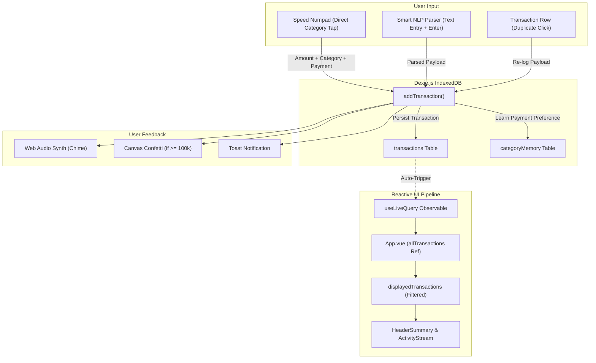

# UangKu Codebase Documentation

This document provides a comprehensive technical overview and architecture map of the **UangKu** codebase.

---

## 1. System Overview

**UangKu** is a client-side, offline-first Progressive Web App (PWA) designed for ultra-low-friction personal expense tracking in Indonesian Rupiah (IDR).

### Key Architectural Pillars
* **Zero Remote Server Dependency**: Dexie.js (IndexedDB) acts as the single source of truth for all transactional data and category memory.
* **Instant Reactivity**: Vue 3's Composition API coupled with Dexie's `liveQuery` provides instant, reactive UI updates whenever data changes.
* **Sub-3-Second Logging**: Dual input system featuring a rapid numeric keypad with one-tap category assignment and an Indonesian Natural Language Processing (NLP) text parser.
* **Native Audio Feedback**: Browser Web Audio API synthesizer generates immediate acoustic tactile feedback without downloading external audio assets.
* **Mobile-First PWA**: PWA manifest and service worker configuration for standalone home-screen installation and offline access.

---

## 2. Directory Structure

```
uangku/
├── .github/
│   └── workflows/
│       └── deploy.yml              # GitHub Actions deploy to GitHub Pages
├── public/
│   ├── favicon.svg                 # SVG application favicon
│   ├── apple-touch-icon.png        # iOS touch icon
│   ├── pwa-192x192.png             # PWA standard icon
│   └── pwa-512x512.png             # PWA splash/maskable icon
├── src/
│   ├── components/                 # Vue 3 UI components
│   │   ├── ActivityStream.vue      # Chronological feed grouped by day with search
│   │   ├── AnalyticsModal.vue      # Spending distribution by category modal
│   │   ├── BottomNavbar.vue        # Persistent bottom navigation bar with (+) FAB
│   │   ├── CategoryIcon.vue        # Dynamic Lucide icon renderer for categories
│   │   ├── ControlCenter.vue       # Full-view slide-up sheet hosting entry modes
│   │   ├── ExportModal.vue         # CSV/JSON export, JSON restore, sample data loader
│   │   ├── HeaderSummary.vue       # Sticky header with total display, splits, filters
│   │   ├── PwaInstallPrompt.vue    # Offline banner and PWA install prompt
│   │   ├── SmartParserInput.vue    # Indonesian NLP text entry with live preview
│   │   ├── SpeedNumpad.vue         # Numeric keypad with 9 direct-tap category chips
│   │   ├── ToastNotification.vue   # Floating toast status notifications
│   │   └── TransactionItem.vue     # Individual transaction row with actions
│   ├── composables/                # Reusable Vue composables
│   │   ├── useAudioFeedback.ts     # Reactive wrapper for Web Audio synthesizer
│   │   └── useLiveQuery.ts         # Dexie liveQuery bridge to Vue 3 Ref
│   ├── db/                         # Database layer
│   │   ├── index.ts                # Dexie database instance, helpers, and sample seed
│   │   └── types.ts                # TypeScript interfaces for data models
│   ├── utils/                      # Pure utility functions & logic
│   │   ├── audio.ts                # Web Audio API procedural audio synthesizer
│   │   ├── categories.ts           # 9 spending categories configuration
│   │   ├── csv.ts                  # CSV and JSON import/export routines
│   │   ├── currency.ts             # Indonesian Rupiah formatting and abbreviation
│   │   ├── currency.test.ts        # Unit tests for currency formatting
│   │   ├── date.ts                 # Date grouping, relative time, and filters
│   │   ├── nlpParser.ts            # Indonesian NLP expense parser logic
│   │   └── nlpParser.test.ts       # Vitest suite for NLP parser
│   ├── App.vue                     # Root application coordinator
│   ├── main.ts                     # Application entry point
│   ├── style.css                   # Tailwind CSS base and custom utility classes
│   └── vite-env.d.ts               # Vite client environment declarations
├── AGENTS.md                       # Operational guidelines for AI agents
├── CODEBASE.md                     # Codebase documentation (this file)
├── DESIGN.md                       # Design system and UI/UX specification
├── index.html                      # HTML5 template entry point
├── package.json                    # Project dependencies and script declarations
├── postcss.config.js               # PostCSS configuration for Tailwind
├── tailwind.config.js              # Custom Tailwind theme tokens (Warm Sand & Matcha)
├── tsconfig.json                   # TypeScript compiler configuration
└── vite.config.ts                  # Vite build configuration with PWA plugin
```

---

## 3. Core Architectural Modules

### 3.1 Database Layer (`src/db/`)

The persistence engine relies on **Dexie.js** wrapping browser `indexedDB`.

#### Data Models (`src/db/types.ts`)
* `PaymentType`: `'tunai' | 'rekening'`
* `Transaction`:
  ```typescript
  interface Transaction {
    id?: number;          // Auto-incremented primary key
    amount: number;       // Value in Rupiah (e.g. 25000)
    category: string;     // One of the 9 defined categories
    type: PaymentType;    // 'tunai' or 'rekening'
    note?: string;        // Optional transaction memo
    timestamp: string;    // ISO 8601 string
  }
  ```
* `CategoryMemory`:
  ```typescript
  interface CategoryMemory {
    category: string;           // Category Name
    preferredType: PaymentType; // 'tunai' or 'rekening'
  }
  ```
* `TimeFilter`: `'today' | '7days' | 'month' | 'all'`

#### Database Class & Functions (`src/db/index.ts`)
* `UangKuDatabase`: Extends `Dexie`. Schema version 1 registers:
  - `transactions: '++id, amount, category, type, timestamp'`
  - `categoryMemory: 'category, preferredType'`
* `addTransaction(data)`: Appends an expense to `transactions` and updates `categoryMemory` with the selected payment method.
* `deleteTransaction(id)`: Deletes an expense by primary key.
* `getPreferredPayment(categoryName)`: Queries `categoryMemory` for the user's historical payment preference; falls back to the category's `defaultType`.
* `setPreferredPayment(categoryName, type)`: Updates user preference in `categoryMemory`.
* `clearAllData()`: Empties `transactions` and `categoryMemory`.
* `seedSampleData()`: Seeds realistic Indonesian sample transactions (Kopi Kenangan, Nasi Padang, Gojek, Token Listrik PLN, Bioskop XXI, Apotek).

---

### 3.2 Reactivity Layer (`src/composables/`)

#### `useLiveQuery.ts`
Binds Dexie's RxJS-style `liveQuery` observable to a Vue 3 `ref`.
* Leverages `watchEffect` to automatically recreate subscription when reactive dependencies change.
* Cleans up subscription on component unmount to prevent memory leaks.
* Example usage:
  ```typescript
  const allTransactions = useLiveQuery(
    () => db.transactions.reverse().toArray(),
    []
  );
  ```

#### `useAudioFeedback.ts`
Provides reactive controls for UI audio cues:
* `triggerSuccess()`: Triad chime on expense creation and duplication.
* `toggle()`: Flips sound enabled state and saves to `localStorage`.
* `soundActive`: Reactive boolean reflecting current sound state.

---

### 3.3 Indonesian NLP & Formatting Engine (`src/utils/`)

#### `nlpParser.ts`
Parses freeform Indonesian text inputs in real-time into structured data:
1. **Amount Detection**:
   - Multipliers: `k`, `rb`, `ribu` ($\times 1.000$); `jt`, `juta`, `m`, `mio` ($\times 1.000.000$).
   - Formatted numbers: `Rp 25.000`, `25.000`.
   - Raw digits: `25000`, `150000`.
2. **Payment Detection**:
   - `tunai`: `cash`, `tunai`, `uang pas`, `dompet`.
   - `rekening`: `card`, `kartu`, `debit`, `kredit`, `cc`, `bca`, `mandiri`, `bni`, `bri`, `gopay`, `ovo`, `dana`, `qris`, `transfer`, `rekening`, `bank`, `jago`, `seabank`, `shopeepay`.
3. **Category Detection**:
   - Evaluates text against keyword vocabularies across all 9 categories.
   - Preserves merchant/item descriptors (e.g., `warung`, `resto`, `nasi padang`, `kopi`) from being stripped out of the memo note when followed by descriptor text.
4. **Memo Note Extraction**:
   - Strips matched amount and payment tokens.
   - Cleans leading and trailing Indonesian prepositions (`di`, `ke`, `buat`, `untuk`, `via`, `pake`).

#### `categories.ts`
Registers the 9 core categories:
1. `Makanan` (🍱 Utensils, default: `tunai`)
2. `Transportasi` (🚕 Car, default: `rekening`)
3. `Tagihan` (💡 Zap, default: `rekening`)
4. `Shopping` (🛍️ ShoppingBag, default: `rekening`)
5. `Hiburan` (🎬 Gamepad2, default: `rekening`)
6. `Kesehatan` (💊 HeartPulse, default: `tunai`)
7. `Edukasi` (📚 GraduationCap, default: `rekening`)
8. `Hutang` (🤝 Handshake, default: `rekening`)
9. `Lainnya` (📦 Package, default: `tunai`)

#### `audio.ts`
Implements a procedural sound synthesizer using the native `AudioContext`:
* `playSuccess()`: Arpeggiated C-major triad (C5 $523.25\text{Hz}$, E5 $659.25\text{Hz}$, G5 $783.99\text{Hz}$) with triangle wave oscillators.

#### `currency.ts` & `date.ts`
* `currency.ts`: `formatRupiah(amount)` produces `Rp 25.000`; `formatCompactRupiah(amount)` produces `25 rb` or `1,5 jt`.
* `date.ts`: `getRelativeDayLabel(isoString)` generates Indonesian relative headers (`Hari Ini`, `Kemarin`, `2 hari lalu`, or `12 Okt 2026`). `filterTransactionsByTime(transactions, filter)` supports filtering by `today`, `7days`, `month`, or `all`.

#### `csv.ts`
* `exportToCsv(transactions)`: Downloads `uangku-transaksi-YYYY-MM-DD.csv`.
* `exportToJson(transactions)`: Exports complete JSON backup.

---

### 3.4 Component Architecture (`src/components/` & `src/App.vue`)

#### `App.vue`
The root component that manages:
* Top-level state: `currentFilter`, `isInputPaneOpen`, modal visibility (`isAnalyticsOpen`, `isExportOpen`), and toast messaging.
* Dexie reactive query: `allTransactions` via `useLiveQuery`.
* Filtered transaction computation via `filterTransactionsByTime`.
* Transaction actions: `handleLogExpense`, `handleDuplicate`, and `handleDelete`.
* Celebration effect: Triggers `canvas-confetti` burst when expense amount $\ge 100.000$ IDR.
* First-run detection: Checks transaction count and seeds demo data on initial launch.

#### `BottomNavbar.vue`
Fixed navigation bar at the bottom:
* **Riwayat** (History): Scrolls main feed back to top.
* **Center (+) FAB**: Prominent matcha green button with elevated circular styling (`-mt-5`) that opens the slide-up input pane.
* **Analisis**: Opens `AnalyticsModal`.

#### `ControlCenter.vue`
A full-screen slide-up sheet (`slide-up` CSS transition):
* Header contains:
  - Down chevron (`ChevronDown`) button to dismiss the pane.
  - Mode switcher tabs: **Mode Cepat** (Numpad) vs **Input Pintar** (NLP).
* Hosts `SpeedNumpad` or `SmartParserInput` dynamically.

#### `SpeedNumpad.vue`
Primary high-speed logging interface:
* IDR amount display with real-time numeric accumulation.
* Payment method toggle (`Tunai` vs `Rekening`).
* Optional quick memo text input.
* 9-Category Direct-Commit Matrix: Tapping any category chip logs the expense immediately.
* 4-Column Numeric Keypad:
  - Digits `1`-`9`, `0`.
  - Single `+000` multiplier button spanning two rows (`row-span-2`).
  - Backspace (`Delete`) and Reset (`RotateCcw`).
* Shake animation on zero-value category tap.

#### `SmartParserInput.vue`
Freeform natural language text logging:
* Textarea with autofocus capability and Enter-key submission.
* Real-time parsed output card with interactive badges for amount, category, and payment method.
* Quick example prompts for Indonesian phrasing.

#### `HeaderSummary.vue`
Sticky top header:
* App branding with offline badge.
* Dynamic spending total card with subtle gradient background.
* Payment split breakdown pills (`Tunai` vs `Rekening`).
* Filter selector pills (`Hari Ini`, `7 Hari`, `Bulan Ini`, `Semua`).
* Quick action icons: sound toggle, analytics modal trigger, export modal trigger.

#### `ActivityStream.vue` & `TransactionItem.vue`
* `ActivityStream.vue`: Groups transactions chronologically by relative day label; incorporates a real-time search filter across categories, notes, amounts, and payment types; renders empty state when no transactions match.
* `TransactionItem.vue`: Renders individual card with category icon, category title, payment badge, optional memo, timestamp, formatted amount, and hover/touch quick actions (`Duplicate` and `Delete`).

#### `AnalyticsModal.vue` & `ExportModal.vue`
* `AnalyticsModal.vue`: Categorical percentage breakdowns, horizontal progress bars, payment ratio comparisons, and average spending per transaction.
* `ExportModal.vue`: Data backup and restore interface supporting CSV downloads, JSON exports, JSON file upload restorations, sample data seeding, and full database wipes.

---

## 4. Data Flow & Lifecycles



---

## 5. Development & Testing

### Build & Test Scripts
```bash
# Start development server
npm run dev

# Run TypeScript typecheck
npm run typecheck

# Run Vitest test suite
npm run test

# Build production bundle
npm run build

# Preview production build locally
npm run preview
```

### Unit Tests
* `src/utils/nlpParser.test.ts`: Tests amount extraction, Indonesian multipliers (`k`, `rb`, `jt`), payment method keywords, category detection, and note memo preservation.
* `src/utils/currency.test.ts`: Tests standard Rupiah formatting and compact notation.
